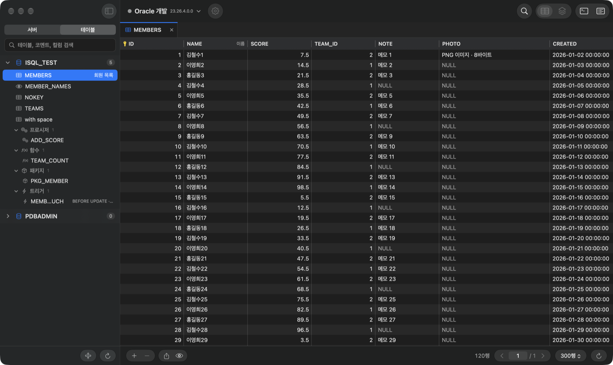
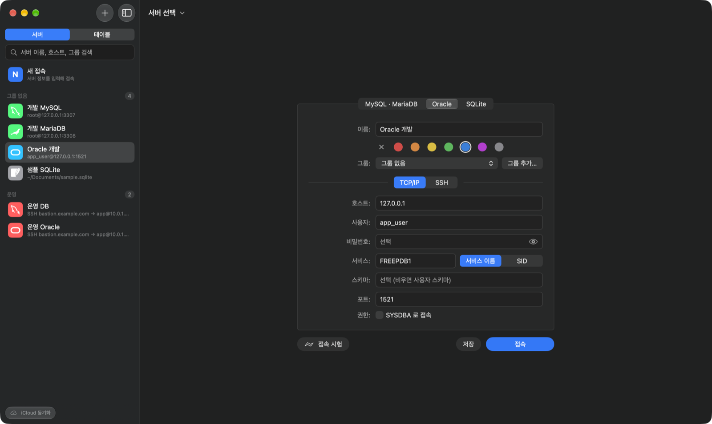
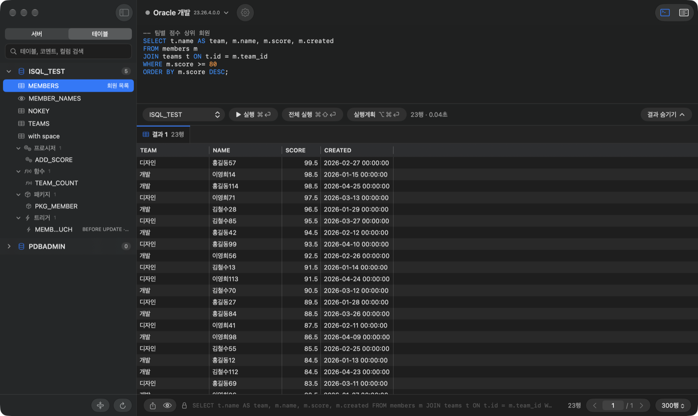
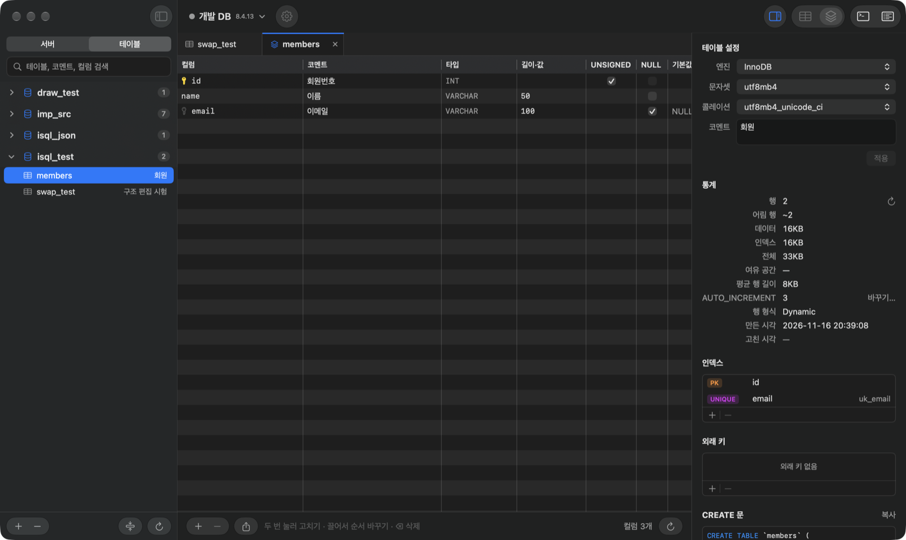
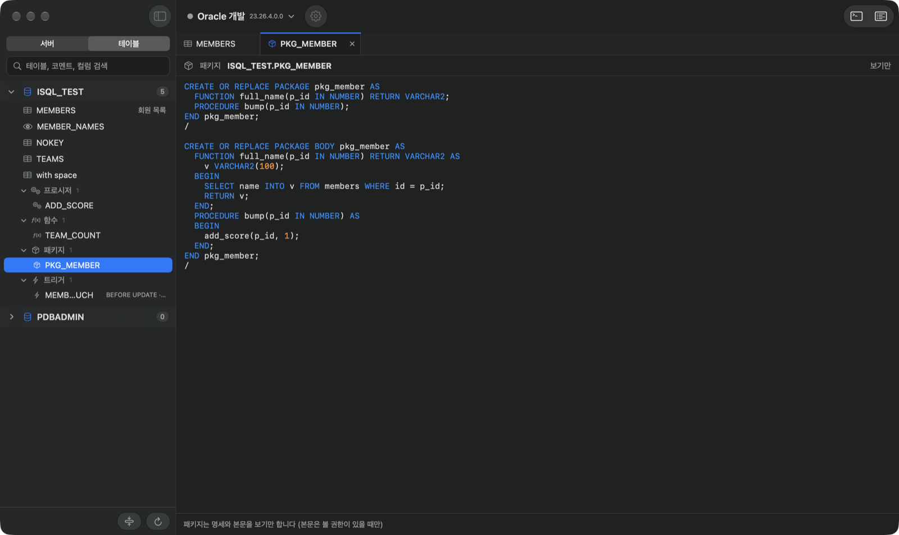

# iSQL

맥에서 쓰는 **MySQL / MariaDB / SQL Server(베타) / Oracle(베타) / SQLite 클라이언트**입니다.
서버의 모든 데이터베이스와 테이블을 사이드바 하나에 코멘트와 함께 보여 주고, 탭·쿼리 패널·구조 편집을 한 창에서 다룹니다.
원격 DB 는 SSH 터널로 접속하고, 비밀번호는 키체인에만 둡니다.



| 서버 목록 · 접속 | 쿼리 패널 |
|---|---|
|  |  |
| **구조 · 테이블 정보 (MySQL)** | **패키지 보기 (Oracle)** |
|  |  |

## 내려받기

[GitHub Releases](https://github.com/moimz/iSQL/releases/latest) 에서 dmg 또는 zip 을 받으세요 (Apple 공증을 받은 Developer ID 앱).
설치한 뒤에는 새 버전이 나오면 앱이 알려 주고 바로 업데이트합니다 (iSQL 메뉴 > 업데이트 확인…, 앱 설정 > 일반 > 업데이트).

## 기능

**접속**
- 접속 정보와 SSH 터널(비밀번호 또는 키 파일)을 한 화면에서 입력, 접속 시험
- DB 종류 탭: MySQL · MariaDB (접속하면 서버 버전으로 둘을 가림) / SQL Server / Oracle (서비스 이름 · SID, SYSDBA) / SQLite (파일 고르기 · 새로 만들기)
- MySQL · MariaDB · SQL Server 는 TLS 직접 접속 (지원하면 사용 · 필수 · 인증서 확인, CA 파일 지정)
- SQLite 파일은 Finder 에서 두 번 누르기 · 창이나 Dock 아이콘에 끌어 놓기로도 열기
- 비밀번호는 모두 iCloud 키체인(동기화 항목)에 저장, 서버 목록은 iCloud Drive 로 다른 맥과 동기화
- 서버 그룹, 끌어다 놓아 정리, 서버 색, 접속 문자열 복사
- 서버 정보 내보내기 · 가져오기 (`.isql`, 암호를 건 파일), Sequel Ace · DBeaver · MySQL Workbench 에서 접속 목록 옮겨 오기
- 제목바의 서버 메뉴로 여러 서버를 오가며, 서버마다 열어 둔 탭을 기억
- 앱 열 때 자동 접속 (서버별, 또는 마지막에 접속해 있던 서버). 보던 서버를 먼저 띄우고 나머지는 뒤에서
- 아이디·비밀번호가 틀리면 로그인 창을 바로 띄우고, 접속되면 서버 정보에 저장
- 접속 허용 IP: 서버마다 이 DB 에 들어갈 수 있는 이 맥의 IP(범위 가능)를 적어 두면, 접속 전에 이 맥의 공인 IP 를 확인합니다. 인터페이스에 붙은 공인 IP 를 먼저 보고, 내부망이면 Wi-Fi · 이더넷 · VPN 마다 따로 `api.ipify.org` 에 묻습니다. 허용 IP 가 아니면 접속하지 않고 macOS 에 등록된 VPN 목록을 시트로 띄워 바로 켜게 하고, 연결되면 다시 확인해 이어서 접속합니다 (접속 시험도 같음)

**탐색**
- 사이드바에 모든 DB 의 테이블을 코멘트와 함께 (DB 머리는 위에 붙어 있음), 자주 쓰는 테이블은 맨 위에 고정
- ⌘K 빠른 열기: 테이블·DB 이름을 띄엄띄엄 쳐서 찾아 열기 (⌘↵ 분할 화면에), 최근 연 것
- 프로시저 · 함수 · 트리거 · 이벤트 (Oracle 은 패키지도 — 명세 · 본문 보기만): 사이드바 DB 아래 묶음, 탭에서 SQL 로 보고 고치기(저장하면 지우고 다시 만들고, 실패하면 원래 것으로 되돌림), 새로 만들기 · 지우기, 이벤트 켜고 끄기, 프로시저 · 함수 실행(인자를 넣어 CALL · SELECT 를 쿼리 패널에), 뷰 정의 고치기(CREATE OR REPLACE)
- 테이블 이름 · 코멘트 · 컬럼 이름 · 컬럼 코멘트 검색
- DB 개요: 테이블별 행 수 · 데이터/인덱스 크기 · 엔진 · 콜레이션 (phpMyAdmin 구조 화면처럼)
- 분할 화면: 다른 서버·DB 의 테이블을 나란히, 세로 스크롤 맞추기

**데이터**
- 테이블마다 탭, 데이터 / 구조 보기 (⌘1 / ⌘2), 탭 끌어 순서 바꾸기
- 탭은 크롬처럼: ⌘W 닫기, ⌘[ ⌘] 옆 탭으로, ⌃Tab 직전에 보던 탭과 오가기, ⇧⌘T 닫은 탭 다시 열기 (원래 자리에, 최근 것부터)
- 조건 줄로 WHERE 만들기(테이블마다 최근 10개 기억), 칸 우클릭 "현재 값으로 검색", 컬럼 제목으로 정렬
- 페이지 나누기 (InnoDB 는 어림 행 수, 눌러서 `COUNT(*)`)
- 칸 고치기 · 행 추가 · 복제 · 삭제를 모았다가 한 트랜잭션으로 저장 (SQL 미리보기)
- 엑셀처럼 지금 칸을 ← → 로 옮기고 엔터로 고치기, 컬럼 고정, 컬럼 순서 바꾸기·복원
- 복사: 값 · 행 · 컬럼 이름 포함 · INSERT 문 · JSON · IN 목록. 엑셀에 붙이면 칸 안 줄바꿈과 앞자리 0 유지
- JSON 편집기: JSON 컬럼, 또는 JSON 처럼 보이는 글자 칸(우클릭 "JSON 으로 편집…"). 펼쳐서 색칠, 틀린 줄 · 칸 짚기. 안 고쳤으면 원본 그대로, 고쳤으면 원래 모양(한 줄 · 공백 · 들여쓰기)대로 저장
- 숫자 컬럼을 날짜로 보기 (유닉스 시간 초 · 밀리초 · 마이크로초, 제목 우클릭). 날짜를 넣으면 숫자로 저장. 보여 줄 시간대는 앱 설정 > 일반 > 시간 표시
- BLOB: 파일 형식 표시(PNG 이미지 · 24KB), 훑어보기, 파일로 저장 · 파일에서 불러오기. 64KB 넘는 값은 앞부분과 크기만 읽고, 복사 · 훑어보기 · 저장할 때 그 칸만 다시 읽음 (기본 키가 있는 테이블)

**쿼리 패널** (⌘J)
- 서버마다 하나, 입력한 내용은 지우지 않고 남고 iCloud 로 여러 맥에서 같이 씀 (즐겨찾기·기록 대신)
- 오른쪽 끝 [사용자 | MCP]: AI(MCP)가 넣어 준 쿼리는 [MCP] 칸에 따로 쌓여 내 쿼리와 섞이지 않음 (이 맥에만, 최근 50개)
- 테이블 · 컬럼 · DB · 키워드 자동완성 (코멘트로도 찾음)
- 글자 색칠: 키워드 · 글자 · 숫자 · 주석 (쿼리 패널과 루틴 · 뷰 정의 탭)
- 여러 문장 실행, 결과 탭(문장마다 걸린 시간), `LIMIT` 없는 SELECT 는 자동으로 나눠 받기
- 실행 중에는 누른 버튼이 취소 버튼(⌘.)으로 바뀌어 서버에서 쿼리를 멈춤. 데이터 탭도 읽는 중에는 새로고침 자리의 빨간 ■ 로 멈춤
- 한 테이블에서 온 결과는 바로 고쳐 저장, 결과로 뷰 만들기
- WHERE 없는 UPDATE, DELETE, DROP, TRUNCATE, ALTER 는 실행 전에 확인
- 실행계획 (⌥⌘↩): EXPLAIN 나무(MySQL 8) + 표, 전체 훑기·filesort·임시 테이블·안 쓴 인덱스는 색칠과 경고

**콘솔** (⇧⌘L)
- 앱이 서버에 보낸 모든 쿼리(시각 · 서버 · DB · 걸린 시간 · 오류 메시지), 찾기 · 저장 · 쿼리 패널에 넣기
- 오류 줄은 옅은 빨강, 위험 쿼리(WHERE 없는 UPDATE · DELETE, DROP 등)는 옅은 노랑, 시각 제목을 누르면 순서 뒤집기

**구조**
- 컬럼 편집(추가 · 복제 · 순서 · 타입 · 기본값), 저장할 때 ALTER 한 번
- 테이블 정보 패널(⌥⌘I): 엔진 · 문자셋 · 콜레이션 · 코멘트, 정확한 행 수와 크기, AUTO_INCREMENT,
  인덱스 · 외래 키 추가 / 수정 / 삭제, 이 테이블을 참조하는 키, CREATE 문 보기 · 복사
- 테이블 이름 바꾸기 · 복제(구조만 / 구조와 데이터)

**가져오기 · 내보내기 · 복제**
- SQL 내보내기: 테이블, 고른 테이블들, DB 전체, 쿼리 결과 (구조 / DROP / 데이터 선택, 진행 창). 구조를 넣으면 그 테이블의 트리거도 맨 끝에 (데이터를 넣은 뒤 만들어 넣는 행에 돌지 않게)
- 엑셀(xlsx) 내보내기 · 가져오기 (외부 라이브러리 없이 직접), 숫자 · 날짜 형식 유지
- SQL 파일 가져오기 (큰 덤프도 조금씩, 오류 난 문장에서 멈춤)
- iModules 형식(package.json 의 databases) 내보내기
- 데이터베이스 복제: 원본과 같은 문자셋 · 콜레이션으로 새 DB 를 만들고 구조와 데이터를 옮김.
  데이터는 테이블마다 트랜잭션 하나 안에서 기본 키 순서로 5,000행씩 넣어 원본을 오래 잠그지 않음.
  프로시저 · 함수 · 트리거 · 이벤트도 함께 (데이터를 넣은 뒤에 만들고, 이벤트는 꺼진 채로)
- 데이터베이스 이름 바꾸기: 새 DB 를 만들고 테이블을 RENAME TABLE 로 옮김(복사 없이 빠름), 뷰는 다시 만듦. 트리거가 있으면 막고, 프로시저·이벤트가 있으면 옛 DB 를 남김
- 컬럼 숨기기(제목 우클릭, 끝의 "(N개 컬럼 숨겨짐)" 칸에서 다시 보이기), 탭 메뉴 "컬럼 복원" 으로 순서 · 숨김을 원래대로
- 뷰 만들기: 쿼리 결과 · 지금 보는 데이터(찾기 조건 · 정렬 · 컬럼 순서 · 숨김 그대로)로. "나만 보기" 면 서버에 만들지 않고 iCloud 에 두는 나만 보는 뷰(사이드바에 자물쇠 눈)
- 서버마다 새 데이터베이스 · 새 테이블의 기본 문자셋 · 콜레이션 (서버 설정 > 일반)

**서버 설정 창** (제목바 톱니, MySQL · MariaDB · SQL Server)
- 상태: 가동 시간 · 연결 · 초당 쿼리 · 느린 쿼리 · 버퍼 풀 적중률 요약, 프로세스 목록(오래 도는 쿼리 노랑 · 잠금 대기 빨강, 쿼리 멈추기 · 연결 끊기), 쿼리 통계 (MySQL 은 performance_schema, SQL Server 는 계획 캐시). 5초마다 새로 읽음
- 서버 설정: 서버 변수 보기 (자주 보는 변수는 위에 설명과 함께)
- 사용자 계정 · 권한 (MySQL, SQL Server · Oracle 은 보기만)

**MCP**
- Claude 같은 AI 도구가 iSQL 로 DB 를 볼 수 있는 로컬 MCP 서버 (앱 설정에서 켜고, 읽기 전용부터 권한을 고름)
- 접근 범위(지금 보는 서버 · 접속한 서버 · 모든 서버)와 쿼리 권한을 고름: 읽기 전용(그 밖은 거절) · 안전한 쿼리만 자동 허용(읽기 · INSERT · WHERE 있는 UPDATE · 컬럼 추가는 바로, DELETE · DROP 같은 그 밖은 허용 창을 띄워 물음, 2분 안에 답이 없으면 거절) · 모든 쿼리 자동 허용. 이 맥 안(127.0.0.1)에서만 받고, 비밀번호는 넘기지 않음. 설정 > MCP 의 [연결 명령 복사] 로 Claude Code 에 연결
- 보기 · 실행: `list_servers` · `list_databases` · `list_tables` · `describe_table` · `run_query` (쿼리 권한에 따라 바로 실행 · 물음 · 거절)
- 진단: `server_status` · `top_queries` (서버 상태 요약 · 프로세스 목록 · 쿼리 통계, 서버가 느린 원인 진단용)
- 나만 보는 뷰: `create_private_view` · `update_private_view` · `list_private_views` — "이런 데이터를 보고 싶다" 고 하면 AI 가 조인 · 서브쿼리를 짜서 나만 보는 뷰(이름 앞 ✨)로 저장하고 탭으로 열어 줌 (SELECT 한 문장만, 저장 전에 한 번 실행해 오류 확인)
- 화면: `open_table`(데이터 · 구조, 조건으로 걸러서) · `open_database` · `refresh` · `show_query`(쿼리 패널 [MCP] 칸에 넣고 골라 두기, 실행까지 하면 `run_query` 와 같은 권한 규칙)
- 엑셀: `import_excel` — 엑셀 파일을 iSQL 의 엑셀 가져오기로 새 테이블에 넣고 탭을 엶 (읽기 전용 권한이면 안 함)
- MCP 로 테이블을 바꾸면 열려 있는 그 테이블 탭을 바로 다시 읽음 (저장 안 한 편집이 있는 탭은 건드리지 않음)
- 접속 허용 IP 가 아닌 서버는 MCP 도 접속하지 않고, 본 IP 와 이 맥의 VPN 목록을 알려 줌 (AI 가 VPN 을 켜 달라고 안내)
- 앱에 쓴 쿼리 입력창의 내용은 MCP 로 읽을 수 없음

**그 밖에**
- 앱 설정 > 일반 > 시간 표시: 날짜로 보는 컬럼과 Oracle 의 시간대가 붙은 값을 보여 줄 시간대 (시스템 시간대 또는 지역 목록)
- 메뉴 막대에 모든 단축키 (보기 · 파일 · 윈도우)

## 단축키

| 단축키 | 하는 일 |
|---|---|
| ⌘1 / ⌘2 | 데이터 보기 / 구조 보기 |
| ⌘R | 새로고침 |
| ⌘S | 저장 (데이터 · 구조 · 루틴 · 쿼리 결과) |
| ⌘W | 탭 닫기 (탭이 없으면 창 닫기) |
| ⇧⌘W | 창 닫기 |
| ⌘[ / ⌘] | 이전 탭 / 다음 탭 |
| ⌃Tab | 직전에 보던 탭 |
| ⇧⌘T | 닫은 탭 다시 열기 |
| ⌘K | 빠른 열기 |
| ⌥⌘F | 조건 줄 |
| ⌥⌘I | 테이블 정보 |
| ⌘J | 쿼리 패널 |
| ⇧⌘L | 콘솔 |
| ⌘↩ / ⇧⌘↩ | 쿼리 실행 (커서가 있는 문장 · 고른 부분) / 전체 실행 |
| ⌥⌘↩ | 실행계획 |
| ⌘. | 실행 중인 쿼리 취소 |

쿼리 패널이 열려 있으면 탭 단축키(⌘W · ⌘[ ⌘] · ⌃Tab · ⇧⌘T)는 동작하지 않습니다 (쿼리를 쓰다가 탭이 닫히지 않게).

## 요구 사항

- macOS 26 이상, Apple silicon(arm64)
- 빌드: Xcode 26 이상
- 서버: MySQL 5.7 / 8.x (`mysql_native_password`, `caching_sha2_password` 인증). MariaDB 는 같은 인증 방식이면 접속됩니다. SQL Server 2016 SP1 이상 (ODBC 드라이버 없이 바로). Oracle 12.1 이상 (Oracle Client 없이 바로)

외부 패키지는 자동 업데이트용 [Sparkle](https://sparkle-project.org) 하나입니다. 나머지는 Apple 기본 프레임워크(SwiftUI, AppKit, CryptoKit, CommonCrypto, Security)만 씁니다.
MySQL · SQL Server · Oracle 접속 프로토콜은 직접 구현했고(Oracle 은 python-oracledb · oracle-nio 를 참고), SSH 터널은 macOS 에 들어 있는 `/usr/bin/ssh` 를 씁니다.

## DB 별 지원 범위와 아직 안 되는 것

모든 DB 공통으로, 기본 키가 없는 테이블은 데이터 탭에서 고칠 수 없습니다 (쿼리 패널에서 UPDATE 로).

**MySQL · MariaDB**
- 시험한 서버: MySQL 8.4, MariaDB 11.4
- TLS 직접 접속은 들어 있지만 실제 클라우드 서버(AWS RDS 등)와 MariaDB 에서는 아직 확인하지 못했습니다. 클라이언트 인증서 접속(REQUIRE X509)은 아직 없습니다
- MariaDB 의 ed25519 인증 계정은 아직 접속할 수 없습니다

**SQLite**
- 파일 하나가 DB 하나라 DB 만들기 · 이름 바꾸기 · 복제, 서버 상태 · 계정, 엔진 · 문자셋 기능이 없습니다
- 컬럼 이름 바꾸기 · 추가 · 삭제만 됩니다 (타입 바꾸기는 SQLite 가 지원하지 않음)

**SQL Server (베타)**
- SQL Server 로그인(아이디 · 비밀번호) 인증, TLS(기본 필수), SSH 터널. 사이드바는 데이터베이스 아래 `스키마.테이블` (dbo 는 이름만)
- 시험한 서버: SQL Server 2022 Developer (Docker) 하나뿐입니다. Azure SQL · 2016 · 2019 같은 다른 판은 아직 확인하지 못했습니다
- 사용자 계정 탭은 보기만: 로그인(상태 · 암호 정책 · 기본 DB), 서버 역할 · 권한, DB 마다 이어진 사용자와 역할. 만들기 · 고치기는 쿼리 패널에서
- 아직 없는 것: Windows 인증 · Entra ID(Azure AD) 로그인, 계정 만들기 · 권한 주기, DB 이름 바꾸기 · 복제, 테이블 · 컬럼 설명 고치기(보기만), MARS(연결 하나로 여러 결과를 동시에)
- SQL 파일과 쿼리 패널은 `GO` 줄로 배치를 나눕니다. 프로시저 · 함수 · 트리거 · 뷰 정의는 `;` 로 나누지 않습니다
- 상태 탭의 몇 칸은 MySQL 과 뜻이 다릅니다: 초당 쿼리는 배치 수, 느린 쿼리는 계획 캐시에서 평균 1초 넘는 쿼리의 실행 횟수, 주고받은 양은 패킷 수, 쿼리 통계의 읽은 양은 페이지 수. 쿼리 멈추기는 없고 연결 끊기(KILL)만 됩니다. 다른 세션까지 보려면 VIEW SERVER STATE 권한이 있어야 합니다
- 결과는 다 받은 뒤에 보여 줍니다 (아주 큰 결과는 쿼리 패널에서 TOP 으로 줄여 주세요)

**Oracle (베타)**
- 비밀번호 인증(12c · 11g 방식), 서비스 이름 · SID, SYSDBA, SSH 터널. "데이터베이스" 자리에는 스키마(사용자)가 보입니다
- 시험한 서버: Oracle Database 26ai Free 하나뿐입니다. 19c 같은 운영 서버나 KO16MSWIN949 등 다른 문자셋 DB 는 아직 확인하지 못했습니다
- 아직 없는 것: TLS(TCPS) 접속, Oracle 고유 암호화(NNE)를 강제하는 서버, 스키마 만들기 · 이름 바꾸기 · 복제, 서버 상태, 계정 만들기 · 권한 주기 (사용자 계정 탭은 보기만 — DBA 뷰를 못 읽는 계정이면 이름과 내 계정만), 패키지 고치기 (패키지는 명세 · 본문 보기만)
- 데이터 탭에서 저장할 때 말고는 문장마다 바로 커밋합니다 (MySQL 과 같게)
- 정렬: CLOB 은 앞 4000자로, BLOB · JSON · LONG 은 정렬하지 않습니다. 내림차순이면 NULL 이 맨 위에 옵니다 (Oracle 기본)
- 권한이 적은 계정은 남의 스키마 테이블 정의(DBMS_METADATA)를 읽지 못해, CREATE 문을 컬럼 · 키 · 인덱스 정보로 만들어 보여 줍니다 (외래 키 · 검사 제약 · 저장소 절은 빠짐)
- 엑셀 가져오기: 새 테이블은 NUMBER · VARCHAR2(n CHAR) · DATE · TIMESTAMP(0) · CLOB 형식으로 만듭니다
- 문제가 생기면 콘솔(⇧⌘L)의 오류 메시지와 서버 버전을 알려 주세요

## 빌드

```bash
git clone https://github.com/moimz/iSQL.git
open iSQL/iSQL.xcodeproj
```

프로젝트는 moimz 팀(Developer ID, iCloud 컨테이너 `iCloud.com.moimz.iSQL`)으로 서명하도록 설정돼 있습니다.
직접 빌드하려면 타깃의 **Signing & Capabilities** 에서 팀과 번들 ID를 내 것으로 바꾸고,
iCloud 컨테이너와 키체인 접근 그룹도 내 것으로 바꾸거나 iCloud 기능을 빼세요.
iCloud 를 쓸 수 없으면 서버 목록은 이 맥에만, 비밀번호는 이 맥의 키체인에만 저장합니다.

샌드박스는 쓰지 않습니다 (`ssh` 를 띄워야 하므로).

## 데이터 위치

| 무엇 | 어디 |
|---|---|
| 서버 목록 (iCloud) | iCloud Drive 앱 전용 폴더 `iCloud.com.moimz.iSQL/Data/Servers/<UUID>.json`, `groups.json` |
| 서버 목록 (이 맥만) | `~/Library/Application Support/iSQL/Servers/<UUID>.json` |
| 비밀번호 | 키체인 (iCloud 키체인 동기화 항목, 안 되면 이 맥에만) |
| 쿼리 패널 내용 (저장한 서버) | iCloud Drive 앱 전용 폴더 `Data/Queries/<UUID>.sql` |
| 컬럼 순서 · 너비 · 숨김 · 고정 (저장한 서버) | iCloud Drive 앱 전용 폴더 `Data/Layouts/<UUID>.json` |
| 나만 보는 뷰 (저장한 서버) | iCloud Drive 앱 전용 폴더 `Data/Views/<UUID>.json` |
| 열어 둔 탭, WHERE 기록, 날짜로 보는 컬럼, 퀵 커넥트 서버의 쿼리 내용, 쿼리 패널 [MCP] 칸 | 이 맥의 앱 설정 (UserDefaults) |

서버 하나가 JSON 파일 하나이고, 비밀번호는 파일에 들어가지 않습니다.

## 상표

MySQL · Oracle 은 Oracle 및 그 계열사의 상표이고, SQL Server 는 Microsoft, MariaDB 는 MariaDB Corporation Ab, SQLite 는 Hipp, Wyrick & Company 의 상표입니다. 서버 목록의 로고는 접속한 DB 종류를 알리는 데만 쓰며, iSQL 은 이 회사들과 관계가 없습니다. 로고 그림은 [Simple Icons](https://simpleicons.org) (CC0) 의 것을 줄여 썼습니다.

## 오픈소스

- [Sparkle](https://sparkle-project.org) (MIT) — 자동 업데이트
- [Simple Icons](https://simpleicons.org) (CC0) — DB 로고 그림
- [python-oracledb](https://github.com/oracle/python-oracledb) (UPL 1.0 · Apache 2.0), [oracle-nio](https://github.com/lovetodream/oracle-nio) (Apache 2.0) — Oracle 접속 프로토콜을 참고해 옮김

## 라이선스

[MIT](LICENSE)
